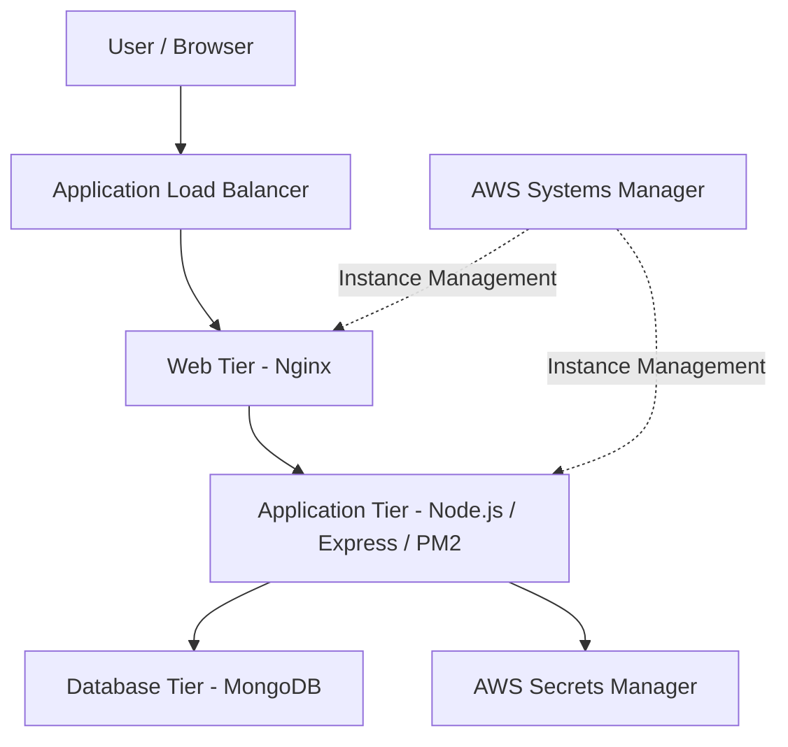

# Three-Tier MERN Application Deployment on AWS

A DevOps portfolio project demonstrating the deployment architecture of a MERN CRUD application using AWS, Terraform, Packer, Linux, and automation scripts.

## Project Overview

This project explores how to provision and prepare AWS infrastructure for a three-tier web application using Infrastructure as Code (IaC).

The application is a MERN-based Inventory Management System (IMS) that supports basic product management operations. The infrastructure is designed to separate the web, application, and database layers, making the architecture easier to manage, secure, and scale.

Rather than manually configuring every server, the project uses Terraform to define AWS infrastructure and Packer to create reusable Amazon Machine Images (AMIs).

The project also demonstrates the use of AWS Systems Manager (SSM) for instance management and AWS Secrets Manager for application configuration.

**Project focus:** Infrastructure automation, cloud architecture, configuration management, and deployment practices.

## Architecture

The infrastructure is organised into three logical tiers:

1. **Web tier:** Hosts the frontend application using Nginx.
2. **Application tier:** Runs the Node.js/Express backend using PM2.
3. **Database tier:** Provides the MongoDB database layer.

The Terraform configuration provisions the supporting AWS infrastructure, including networking, subnets, routing, security groups, compute instances, IAM permissions, and VPC endpoints.

### Architecture flow



The diagram represents the intended application flow and supporting services. Actual connectivity and deployment depend on the corresponding AWS resources and configuration.

## Technology Stack

| Area | Technologies |
| --- | --- |
| Application | MongoDB, Express.js, React, Node.js |
| Web server | Nginx |
| Process management | PM2 |
| Cloud platform | AWS |
| Infrastructure as Code | Terraform |
| Image automation | HashiCorp Packer |
| Operating system | Ubuntu 22.04 |
| Instance management | AWS Systems Manager |
| Secrets management | AWS Secrets Manager |
| Containerisation | Docker, Docker Compose |
| Version control | Git, GitHub |
| Automation | Bash scripting |

## Repository Structure

```text
three-tier-mern-aws/
│
├── App/
│   └── IMG/
│       ├── Backend/
│       │   ├── Models/
│       │   ├── Routes/
│       │   ├── Dockerfile
│       │   ├── db.js
│       │   ├── index.js
│       │   └── package.json
│       │
│       ├── Frontend/
│       │   ├── public/
│       │   ├── src/
│       │   ├── Dockerfile
│       │   ├── nginx.conf
│       │   └── package.json
│       │
│       ├── docker-compose.yml
│       └── README.md
│
├── Infrastructure/
│   └── 3-tier Setup-with-SSM-Packer/
│       ├── Packer/
│       │   ├── scripts/
│       │   │   ├── app-build.sh
│       │   │   └── web-build.sh
│       │   ├── app-tier.pkr.hcl
│       │   └── web-tier.pkr.hcl
│       │
│       ├── 2-provider.tf
│       ├── 3-vpc.tf
│       ├── 5-subnets.tf
│       ├── 6-internet-gateway.tf
│       ├── 7-nat.tf
│       ├── 8-SG.tf
│       ├── 8-route-tables.tf
│       ├── 9-instances.tf
│       ├── 10-outputs.tf
│       ├── iam.tf
│       ├── variables.tf
│       ├── vpc_endpoints.tf
│       ├── web-tier.sh
│       ├── app-tier.sh
│       └── db-tier.sh
│       ├── alb.tf
│       ├── monitoring.tf
│       ├── Route53.tf
│       ├── github-oidc.tf
│
├── .gitignore
└── README.md
```

## AWS Infrastructure

The Terraform configuration is responsible for defining the infrastructure required by the application.

### Networking

The infrastructure configuration includes:

- A custom Amazon VPC.
- Public and private subnets across multiple Availability Zones.
- Internet Gateway for internet connectivity.
- NAT Gateway for outbound connectivity from private subnets.
- Route tables and subnet associations.
- Security groups controlling communication between infrastructure components.
- VPC endpoints to support private access to selected AWS services.

### Compute

EC2 instances are configured to support the different application tiers.

The intended separation is:

- Web instances serve the React frontend through Nginx.
- Application instances run the backend API through Node.js and PM2.
- The database tier provides the data storage layer.

An Application Load Balancer and target group are included in the infrastructure configuration for web-tier traffic distribution.

### Instance management

AWS Systems Manager is used as the preferred instance-management approach, avoiding the need to expose SSH access for routine administration.

The configuration includes IAM instance profiles and permissions intended to support Systems Manager operations.

### Secrets management

AWS Secrets Manager is used to supply sensitive application configuration to the backend deployment script.

The application configuration includes:

- `MONGO_URI`
- `JWT_SECRET`

The application deployment script retrieves these values using the AWS CLI and writes them into a restricted `.env` file on the application instance.

This avoids embedding database credentials and JWT secrets directly into the deployment script.

## Packer: Custom AMI Creation

Packer is used to define reusable AMI build configurations for the web and application tiers.

### Web-tier AMI

The web-tier build script prepares an Ubuntu-based image with:

- Nginx
- Node.js and npm
- Git
- Required system utilities

### Application-tier AMI

The application-tier build script prepares an Ubuntu-based image with:

- Node.js and npm
- PM2
- Git
- AWS CLI
- jq
- Required system utilities

The goal is to separate base server preparation from application deployment.

Terraform currently references an AMI ID directly in its EC2 configuration, so the generated Packer AMI must be updated there when using a newly built image.

## Deployment Approach

The deployment is divided into infrastructure provisioning, machine-image preparation, and application configuration.

### 1. Build the application images

Packer prepares the base web-tier and application-tier AMIs.

### 2. Provision AWS infrastructure

Terraform defines and provisions the networking, security, IAM, and compute resources.

### 3. Configure the web tier

The web-tier user-data script is designed to:

- Retrieve the application source code.
- Install frontend dependencies.
- Build the React application.
- Copy the generated frontend files into Nginx's web directory.
- Restart and reload Nginx.

### 4. Configure the application tier

The application-tier user-data script is designed to:

- Retrieve the backend source code.
- Install backend dependencies.
- Retrieve application secrets from AWS Secrets Manager.
- Create a restricted environment file.
- Start the Node.js application using PM2.
- Configure PM2 to restore the application after a reboot.

### 5. Configure the database tier

The database-tier script is included for database-layer preparation.

The exact database installation, connectivity, and persistence configuration should be reviewed against the final deployment environment before a fresh deployment.

## Validation and Testing

The following configuration checks have been performed during project preparation:

| Component | Validation |
| --- | --- |
| Web-tier Bash script | Bash syntax check passed |
| Web-tier Packer template | `packer validate` passed |
| Application-tier Packer template | `packer validate` passed |
| Terraform configuration | `terraform validate` passed |

These checks confirm that the reviewed scripts and configuration files pass their respective syntax or configuration validation.

They do not establish that a fresh AWS deployment has completed successfully.

## Security Considerations

Security is an important part of the infrastructure design.

This project incorporates the following practices:

- Sensitive environment files are excluded from Git.
- Terraform state files and variable files are excluded from Git.
- Application secrets are retrieved from AWS Secrets Manager.
- Backend environment files are created with restricted file permissions.
- IAM instance profiles are used for AWS service access.
- AWS Systems Manager is preferred for instance management.
- Security groups define communication boundaries between infrastructure components.

**Important:** Never commit AWS credentials, private keys, Terraform state files, database passwords, or application secrets to a public repository.

## Running the Application Locally

The application source includes Dockerfiles and a Docker Compose configuration.

To explore the local container setup:

1. Install Docker and Docker Compose.
2. Review the application environment configuration.
3. Supply your own local environment variables and database settings.
4. Navigate to the application directory.

```bash
cd App/IMG
```

Start the application using:

```bash
docker compose up --build
```

The exact application ports and service configuration should be checked in `docker-compose.yml`.

## Project Status and Limitations

This repository is being prepared as a DevOps portfolio project.

The Terraform and Packer configurations have undergone syntax and configuration validation. However, the current repository should not be interpreted as a freshly deployed and fully verified AWS environment.

Some infrastructure configuration originated from an earlier AWS environment. A fresh deployment requires reviewing account-specific resource references, AMI IDs, variables, IAM permissions, networking, and application dependencies.

The current Packer AMI output is not automatically connected to Terraform; the AMI ID is configured manually.

Node.js 18 is used in the existing build scripts and should be reviewed for migration to a supported LTS release.

The deployment scripts and infrastructure should be tested together in a fresh AWS environment before being considered deployment-ready.

## What This Project Demonstrates

Through this project, I have worked on:

- Designing a three-tier application architecture.
- Provisioning AWS infrastructure using Terraform.
- Preparing reusable machine images with Packer.
- Configuring EC2 instances with Bash and user-data scripts.
- Managing application processes using PM2.
- Serving frontend applications using Nginx.
- Using AWS Systems Manager for instance administration.
- Retrieving application configuration securely through AWS Secrets Manager.
- Organising application and infrastructure code for version control.
- Validating infrastructure configurations before deployment.

## Future Improvements

Planned improvements include:

- Automating Packer AMI outputs and Terraform image references.
- Implementing a fresh end-to-end AWS deployment.
- Migrating to a supported Node.js LTS release.
- Improving database deployment and persistence.
- Improving infrastructure cost management and cleanup automation.
- Complete and verify remote Terraform state migration.
- Implement centralised logging with Grafana Alloy and Loki.
- Introduce OpenTelemetry tracing with a suitable trace backend.
- Add deployment rollback and stronger release verification.
- Evaluate S3 and CloudFront for static frontend hosting in a separate V3 iteration.
- Add verified deployment screenshots and operational test evidence.


## Author

**Promise Opah**

DevOps Engineer | AWS | Terraform | Linux | Docker | CI/CD

This project represents my practical learning and continued development in AWS, Terraform, Packer, Linux, Docker, and DevOps automation.

GitHub: [promise1991](https://github.com/promise1991)

Project Repository: [3-tier-infrastructure-ISM-App-V2](https://github.com/promise1991/3-tier-infrastructure-ISM-App-V2.git)
